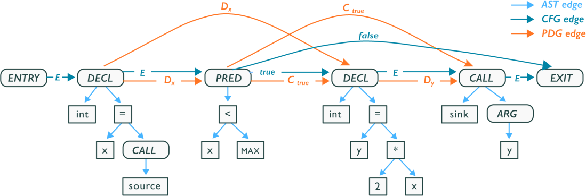

# Root Cause Analysis on Code Property Graph

## Table of Contents

- [Table of Contents](#table-of-contents)
- [Description](#description)
  - [Code Property Graph](#code-property-graph)
  - [Pipeline](#pipeline)
  - [Project Structure](#project-structure)
- [Getting Started](#getting-started)
  - [Requirements](#requirements)
  - [Input: exporting a CPG](#input-exporting-a-cpg)
  - [Running the builder](#running-the-builder)
  - [CLI options](#cli-options)
- [Output Artifacts](#output-artifacts)
  - [Log Trie](#log-trie)
  - [FLOW](#flow)
  - [FSM](#fsm)
  - [Index and summary files](#index-and-summary-files)
- [Core Modules](#core-modules)
- [Notebook: interactive exploration](#notebook-interactive-exploration)
- [Log observability coverage](#log-observability-coverage)
- [Behavioural-model comparison experiment](#behavioural-model-comparison-experiment-evalcomparison)
- [Notes and Known Limitations](#notes-and-known-limitations)

## Description

### Code Property Graph



A Code Property Graph (CPG) combines abstract syntax trees, control flow graphs, and data flow information into a unified graph structure. This enables powerful pattern matching, taint analysis, and semantic code understanding across multiple programming languages.

This project consumes CPGs exported from [Joern](https://cpg.joern.io) (as DOT files) and uses them for **static root cause analysis (RCA)**: reconstructing how a service's entrypoints reach logging statements, so that runtime log lines can later be mapped back onto the source-level call structure that produced them.

### Pipeline

For each service with a pre-built CPG, the pipeline performs three independent extraction steps:

1. **Log Trie** — every logger call (`log.Error`, `logrus.Warn`, `System.out.println`, etc.) reachable from a `CALL` node is traced backwards through `REACHINGDEF` (data-flow) edges to reconstruct its static message template (e.g. `failed to fetch the hostname for the pod <*>`). All templates are indexed into a prefix trie for fast matching against runtime log lines.
2. **FLOW** — starting from each structural entrypoint (a method with `in_degree = 0` in the internal call graph), the CFG is walked forward to build a `SemanticFlowGraph` per reachable method: source-level operations (assignments, conditions, loops, calls, returns) as nodes, and control-flow transitions (including branch labels `TRUE`/`FALSE`/loop conditions) as edges.
3. **FSM** — the `SemanticFlowGraph` of each entrypoint is compacted into a `StaticLogFSM`: a finite-state machine whose states are the *observable intervals* between one logger call and the next (or a return/dead end), and whose transitions are the logger calls themselves. This produces a compact, boundary-minimized automaton suitable for matching sequences of runtime log lines against expected static traces.

```
export.dot (Joern CPG)
        │
        ▼
 networkx.MultiDiGraph
        │
   ┌────┼─────────────────┐
   ▼    ▼                 ▼
 Trie  Entrypoints   (used by both branches below)
        │
        ▼
    EntrypointFlow.build()  ──▶  SemanticFlowGraph  (FLOW)
        │
        ▼
    LogFlowExtractor.extract()  ──▶  StaticLogFSM  (FSM)
```

### Project structure

- `services/*` — directory with Code Property Graphs, one subfolder per service, each containing an `export.dot` (Joern DOT export).
- `src/offline/constants.py` — CPG node/edge label strings matching the Joern DOT export schema, and project-level defaults (e.g. `DEFAULT_PROJECT_PREFIXES`).
- `src/offline/method.py` — `MethodConstructor`: builds a complete, ordered representation (`MethodGraph`) of a single method from its CPG `METHOD` node id (parameters, return type, locals, CFG, PDG, call sites).
- `src/offline/entrypoint.py` — `EntrypointDetector`: finds structural entrypoints using call-graph topology only (`in_degree = 0`, `out_degree ≥ 1` over internal, non-external methods).
- `src/offline/log.py` — builds log message templates from the CPG via backward data-flow traversal, indexes them into a `TrieNode` prefix trie, and renders a Matplotlib visualization.
- `src/offline/flow.py` — `EntrypointFlow`: builds one `SemanticFlowGraph` per reachable method directly from CFG edges (no path enumeration), producing an `EntrypointFlowResult` per entrypoint.
- `src/offline/finite_state_machine.py` — `LogFlowExtractor`: compacts a `SemanticFlowGraph` into a `StaticLogFSM` using a bounded data-flow walk between logger call boundaries.
- `src/offline/visual.py` — Graphviz renderers for `SemanticFlowGraph` (`draw_semantic_graph_graphviz`) and `StaticLogFSM` (`draw_log_fsm_graphviz`).
- `builder.py` — batch entry point: takes a folder of per-service CPGs and produces Trie/FLOW/FSM artifacts for every service and every entrypoint.
- `rca.ipynb` — exploratory notebook used to prototype the pipeline interactively, service by service.
- `output/*` — generated artifacts (see [Output Artifacts](#output-artifacts)), one subfolder per service.

## Getting Started

### Requirements

```bash
pip install networkx matplotlib pydot pandas graphviz
```

`graphviz` (the Python binding) additionally requires the Graphviz binaries to be installed on the system if you enable `--render-graphviz`.

### Input: exporting a CPG

Each service must be exported from Joern as a single `export.dot` file and placed under `services/<service_name>/export.dot`:

```
services/
  frontend/export.dot
  cartservice/export.dot
  checkoutservice/export.dot
```

### Running the builder

```bash
# Process every service found under services/
python3 builder.py --services-dir services --output-dir output

# Process a single service
python3 builder.py --services-dir services --output-dir output --service frontend

# Also render Graphviz PNGs for FLOW and FSM (slower)
python3 builder.py --services-dir services --output-dir output --render-graphviz -v
```

### CLI options

| Flag | Default | Description |
|---|---|---|
| `--services-dir` | `services` | Root folder containing `<service>/export.dot` subfolders |
| `--output-dir` | `output` | Root folder for generated artifacts |
| `--service` | *(all)* | Restrict processing to a single service by folder name |
| `--max-ddg-depth` | `5` | Backward data-flow depth used when reconstructing log templates |
| `--flow-max-depth` | `5` | Maximum interprocedural expansion depth for FLOW |
| `--flow-max-paths` | `50` | Retained for backward compatibility; has no effect on graph construction |
| `--render-graphviz` | off | Additionally render Graphviz PNGs for each entrypoint's FLOW and FSM |
| `-v`, `--verbose` | off | Enable debug-level logging |

## Output Artifacts

Running the builder produces, for each service, an `output/<service>/` folder:

### Log Trie

- `trie.png` — Matplotlib visualization of the prefix trie built from all detected log templates.
- `trie.json` — the same trie serialized as data:
  ```json
  {
    "templates_total": 77,
    "templates": [
      {"call_node_id": "...", "raw_template": "failed to fetch the hostname for the pod <*>", "tokens": ["failed", "..."], "static_count": 8}
    ],
    "trie": {
      "terminals": [],
      "children": { "failed": { "terminals": [...], "children": {...} } }
    }
  }
  ```

### FLOW

One `<entrypoint>.flow.json` per detected entrypoint, containing the entrypoint's `SemanticFlowGraph` for every reachable internal method: nodes (semantic units — assignments, conditions, loops, calls, returns — with `defines`/`uses`/`callee_full_names`), edges (with branch conditions), external calls, and a human-readable `summary`.

Optionally, `<entrypoint>.semantic.png` (Graphviz) when `--render-graphviz` is set.

### FSM

One `<entrypoint>.fsm.json` per entrypoint, containing the compacted `StaticLogFSM`: states (`ExecutionSegment` — observable intervals between logger calls, tagged `START_SEGMENT` / `BETWEEN_LOGS` / `RETURN_SEGMENT` / `INCOMPLETE_SEGMENT`), transitions (`LogTransition` — one per matched logger call, carrying the resolved log template), start/terminal state ids, and a `summary`.

Optionally, `<entrypoint>.fsm.png` (Graphviz) when `--render-graphviz` is set.

### Index and summary files

- `output/<service>/index.json` — one row per entrypoint: status (`ok`/`error`), reachable method count, semantic node/edge counts, FSM state/transition counts, and generated file names.
- `output/<service>/summary.json` — per-service totals: node/edge count of the raw CPG, template count, and entrypoint success/error counts.
- `output/services_index.json` — top-level summary across all processed services.

## Core Modules

| Module | Responsibility |
|---|---|
| `constants.py` | Joern DOT label/attribute constants; default project prefixes |
| `method.py` | `MethodConstructor` — parses one `METHOD` node into parameters, return type, locals, CFG, PDG, call sites |
| `entrypoint.py` | `EntrypointDetector` — topological entrypoint discovery (no naming heuristics) |
| `log.py` | Log template extraction (`build_templates_from_cpg`) + trie construction/matching (`build_trie`, `map_logs`) |
| `flow.py` | `EntrypointFlow` — CFG-to-semantic-graph construction (`SemanticFlowGraph`, `EntrypointFlowResult`) |
| `finite_state_machine.py` | `LogFlowExtractor` — semantic graph to boundary-minimized FSM (`StaticLogFSM`) |
| `visual.py` | Graphviz rendering for FLOW and FSM |
| `builder.py` | Batch CLI orchestrating all of the above across a folder of services |

## Notebook: interactive exploration

`rca.ipynb` mirrors the same pipeline interactively for a single service at a time — useful for inspecting intermediate structures (raw CPG, individual `SemanticFlowGraph`s, FSM transitions) and for prototyping runtime log classification against a built FSM catalog before promoting logic into `builder.py`.

## Log observability coverage

`eval/coverage.py` counts, per service and per entrypoint, the logger calls reachable through FLOW, the ones that are transitions of the entrypoint FSM (visible) and the rest (lost, in a callee or in the entry method). Entrypoints without a visible log are counted as zero-log. Definitions are in its docstring. It reads the `builder.py` output and needs only the standard library.

```bash
python3 -m eval.coverage output coverage/new   # writes coverage.json and coverage.md
python3 -m eval.compare coverage/old/coverage.json coverage/new/coverage.json   # exit 1 if visible decreases or lost increases
```

## Behavioural-model comparison experiment (eval/comparison)

Подробное описание эксперимента — в **[eval/comparison/README.md](eval/comparison/README.md)**
(протокол, метрики, запуск, выходы, текущие результаты). Кратко:

`eval/comparison/run.py` compares the acceptance quality and speed of
three behavioural-model builders on the synthetic test service
`services/retryservice` (CPG at `services/retryservice/export.dot`).

Everything the comparison needs lives under `eval/comparison/`:

```
eval/comparison/
├── run.py                 # single entry point (this experiment)
├── metrics.py             # acceptance-quality metrics (unit-tested)
├── prins_train.py         # isolated-subprocess PRINS training
├── invalid_traces.json    # independently labelled invalid traces
├── data/fixture_data/     # train/test executions + hidden call-site oracle
├── baselines/             # the competitor methods, vendored as-is
│   ├── PRINS/             #   PRINS replication package (MINT inside)
│   ├── LogSynthFSM-KDD-2026/  # LogSynthFSM package
│   ├── prins_data.py      #   log loading/canonicalization helpers
│   └── train_prins.py     #   PRINS training for dataset/re3ob incidents
└── reports/               # generated results
    └── full/              #   per_execution.csv, summary.csv, config.json
                           #   + cpg_rca/, PRINS/, LogSynthFSM/ artifact folders
```

- **cpg_rca** — FSM built from the source-code CPG (`builder.py` offline pipeline);
- **PRINS** — DFA inferred from the train logs by the vendored replication package
  (`baselines/PRINS`, MINT + hybrid determinization), trained in an isolated
  subprocess (`prins_train.py`) to avoid the `src` package-name
  collision between the repo and PRINS;
- **LogSynthFSM** — its FSM stage only: the package's own regex parsing +
  LLM State Discovery (`baselines/LogSynthFSM-KDD-2026`). It requires an
  LLM provider (`OPENAI_API_KEY` or ollama on `localhost:11434`, e.g.
  `docker run -d -p 11434:11434 ollama/ollama` + `ollama pull <model>`);
  when none is available it is reported as `blocked` — no substitute
  implementation is used. The model name is taken from `OLLAMA_MODEL`
  (default `llama3.1`).

Protocol guarantees (see `config.json` of each run for versions, split, seeds):

- identical train/test executions for all methods; only train data feeds the
  log-based methods;
- one shared observable alphabet: every message is canonicalized with
  `normalize_message` (numbers/hex/uuids → `<*>`);
- identical full-acceptance semantics: a trace is accepted iff the model consumes
  *every* event from an initial state and ends in an accepting/terminal state —
  no skipping. For LogSynthFSM (whose states carry no flags) start = states
  without incoming transitions, terminal = states without outgoing ones;
- invalid traces (`eval/comparison/invalid_traces.json`) are labelled from the
  source-code semantics of `retry_service.py`, never from any evaluated FSM;
  `retry budget exhausted` (ERROR) is a *valid* terminal scenario;
- cpg_rca events are normalized at the matching layer with
  `src/online/trie_matcher.normalize_text` — the same policy the online/runtime
  stage applies to messages before template matching, so the evaluated pipeline
  is the full cpg_rca (offline FSM + online matching); offline artefacts
  (trie, FSM JSON) are unaffected by this matching-layer normalization.

Metrics (`eval/comparison/metrics.py`, unit-tested in `tests/test_comparison_metrics.py`):
Recall_valid (fully accepted valid traces), Specificity_invalid (rejected
independently labelled invalid traces), Balanced Accuracy = (R+S)/2 on the
`combined` block, separate Recall_valid for `known` (scenarios present in train)
and `heldout` (test-only) groups, event coverage, build time, per-trace check
time, and log-to-code matching accuracy of cpg_rca against the hidden call-site
oracle (`oracle_events.jsonl`; N/A for the log-based methods).

```bash
python eval/comparison/run.py --retrain-prins    # comparison run (writes reports/full/)
python -m pytest tests/ -q                         # unit tests (incl. metrics)
```

Outputs (per run, default `eval/comparison/reports/full/`):
`per_execution.csv` (method, case_id, ground truth, decision, events processed,
reject reason, check time), `summary.csv` (metric blocks with
numerators/denominators plus a `speed` block), `config.json` (environment,
split, seeds, per-method parameters and statuses), plus per-method artifact
folders: `cpg_rca/` (`trie.json`, `fsm.json` — the built model),
`PRINS/` (`prins_retryservice.pkl` + `.meta.json`, `vocab.json` — message→id
mapping, `prins_work/` — MINT inputs/outputs), `LogSynthFSM/`
(`logsynthfsm_work/` with parsed events and FSM CSVs when a provider is
available).

Latest results (RetryService, 80 valid + 6 invalid traces):

Quality (balanced accuracy on the `combined` block):

| Method | Recall_valid all | known | heldout | Specificity_invalid | BA |
|---|---|---|---|---|---|
| cpg_rca | 1.00 | 1.00 | 1.00 | 0.833 (5/6) | 0.917 |
| PRINS (k=2, u=1) | 0.75 | 1.00 | 0.50 | 1.00 (6/6) | 0.875 |
| LogSynthFSM (FSM-stage, ollama llama3.2:3b) | 0.75 | 1.00 | 0.50 | 1.00 (6/6) | 0.875 |

Speed (`speed` block of `summary.csv`):

| Method | Build, s | Check total, s | Check mean, s | Traces/s |
|---|---|---|---|---|
| cpg_rca | ~9.1 | ~0.0023 | ~2.6e-5 | ~3.8e4 |
| PRINS | ~0.9–1.2 | ~0.0002 | ~2e-6 | ~2.4–4.3e5 |
| LogSynthFSM | ~82 | ~0.004 | ~4.8e-5 | ~2.1e4 |

Note on evaluation fairness: cpg_rca templates extracted from the CPG have
punctuation removed, so acceptance checking normalizes events with the same
online-stage policy (`trie_matcher.normalize_text`) before matching. Matching
raw events against the raw FSM instead collapses cpg_rca's recall to 0.25
(every retry trace dies on the punctuation-bearing event) while leaving PRINS
unchanged — a matching-layer artifact, not a model-quality difference.

